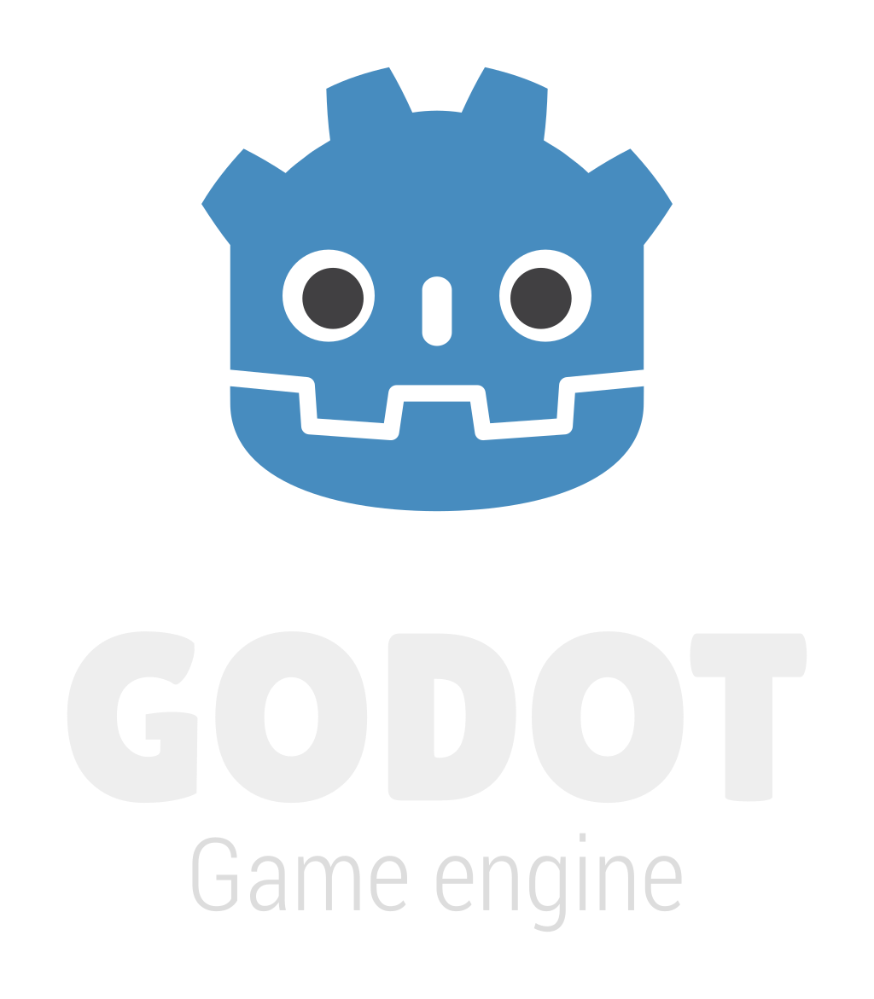
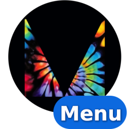
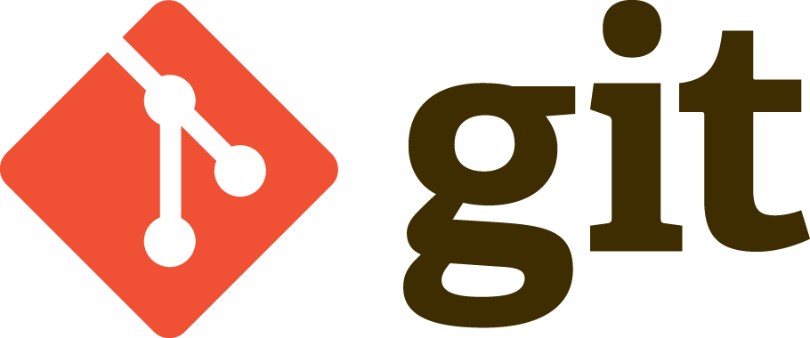

# Attribution

## Project
*Scribe of Eras* is an independent historical career simulation. External assets and tools are credited below.

## Sourced Assets

### Godot Engine Logo
Author: Andrea Calabró  
Source: [Godot Engine Press Kit](https://godotengine.org/press/)  
License: [CC BY 4.0 International](https://github.com/godotengine/godot/blob/master/LOGO_LICENSE.txt)

## Tools

### Godot
  
Author: [Juan Linietsky, Ariel Manzur, and contributors](https://godotengine.org/contact)  
Source: [Godot Engine](https://godotengine.org/)  
License: [MIT License](https://github.com/godotengine/godot/blob/master/LICENSE.txt)

### Maaack's Menus Template
  
Author: [Marek Belski and contributors](https://github.com/Maaack/Godot-Menus-Template/graphs/contributors)  
Source: [Godot Menus Template](https://github.com/Maaack/Godot-Menus-Template)  
License: [MIT License](addons/maaacks_menus_template/LICENSE.txt)

### Maaack's Music Controller
Author: [Marek Belski and contributors](https://github.com/Maaack/Godot-Music-Controller/graphs/contributors)  
Source: [Godot Music Controller](https://github.com/Maaack/Godot-Music-Controller)  
License: [MIT License](addons/maaacks_music_controller/LICENSE.txt)

### Git
  
Author: [Linus Torvalds](https://github.com/torvalds)  
Source: [Git](https://git-scm.com/downloads)  
License: [GNU General Public License version 2](https://opensource.org/licenses/GPL-2.0)
